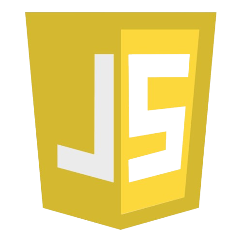
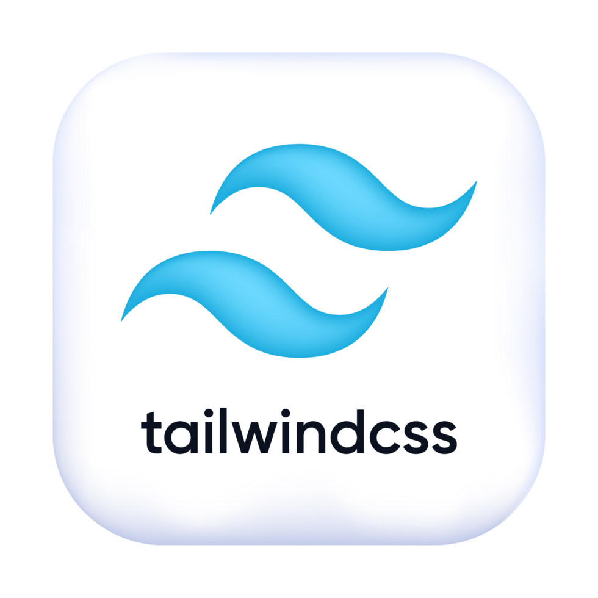
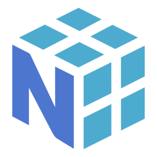
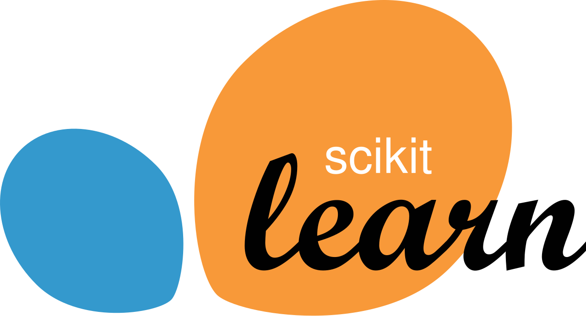
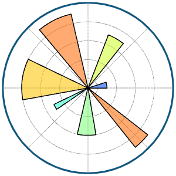
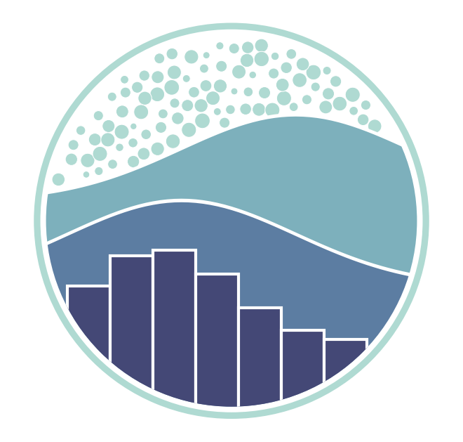
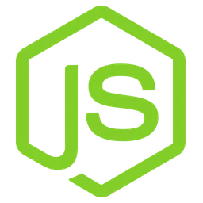
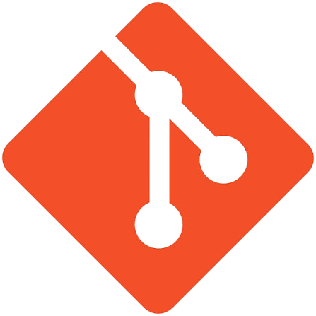

  

<!-- Typing SVG Header -->

  

  <strong>Frontend Developer</strong> &nbsp;|&nbsp; <strong>Data Analyst</strong> &nbsp;|&nbsp; <strong>Python & Data Science Enthusiast</strong>

---

Computer Science grad with a thing for **Data Analytics, ML, and AI** (exploring LLMs, MLOps, and building RAG pipelines with LangChain + FAISS), who turns data into decisions and caffeine into code that (usually) works. I've got a background in **Frontend Development**, so I've spent enough time fighting CSS to know that not every problem has a logical explanation. I mess around with Python, SQL, Web Dev, React, and data, turning messy datasets into insights and random ideas into projects that are actually useful.

Always building something, breaking something, or Googling an error that apparently nobody has ever faced before. **Into open source**, learning new things, and building cool stuff. Basically, I ask questions, break things, fix them, learn something, and call it experience.

**Want to collaborate?** Great, I’m very approachable for someone who talks to a terminal all day. Open an issue, send a PR.

---

### 🛠️ Dev Toolkit & Tech Stack

#### 🌐 Frontend Development

   &nbsp;
   &nbsp;
   &nbsp;
   &nbsp;
   &nbsp;
  

#### 📊 Data Science, ML & Visualization

 &nbsp;
   &nbsp;
   &nbsp;
   &nbsp;
   &nbsp;
   &nbsp;
   &nbsp;
   &nbsp;
   &nbsp;
   &nbsp;
  

#### ⚙️ Backend, Cloud & Tools

   &nbsp;
   &nbsp;
  
   &nbsp;
   &nbsp;
   &nbsp;
   &nbsp;
   &nbsp;

---

### 🌐 Let's Connect

  
  &nbsp;
  
  &nbsp;
  
  &nbsp;
  

  <i>⭐️ From <a href="https://github.com/DrishtiSharma7">Drishti Sharma</a> — Open to Software Engineering, Frontend & Data Analyst Opportunities!</i>

